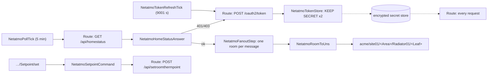

# Netatmo Energy over REST, OAuth 2 on the broker

## What this template does

Brings Netatmo smart radiator valves (NRV), thermostats (NATherm1) and their relay into a
**Unified Namespace** and lets an operator change a room's setpoint from the UNS. Netatmo has no
local API, so the data path is the Netatmo cloud. The whole OAuth 2 refresh-token rotation runs **inside
the Coreflux broker**: no container, no cron script, no token in a file.

A REST Route posts the refresh, an action keeps the rotated pair in the broker's encrypted secret
store, and the Route reads the tokens again per request. They never travel from a client, and never
sit in your git repository.

This is the pattern we run against a live Netatmo account, generalised and hardened by what operating it
taught us. Two of its rules came from failures:

- **Refresh timing.** The refresh period must never put a token refresh in the same second as a
  poll.
- **The secret write.** The token store must only ever write a real token pair.

## What you will see

- `acme/site01/LivingRoom/Radiator01/Temperature` → `{"value":20.5,"timestamp":"2026-10-06T17:20:19Z","datatype":"number","status":"Good","units":"°C"}`.
- `Setpoint`, `SetpointMode`, `HeatingPowerRequest` (%), `OpenWindow`, `Reachable`, valve `Voltage`
  (V), `BatteryState` and `RfStrength` per room.
- `netatmo/discovery`: your home's rooms and valves, plus the ready-to-paste room-map lines.
- A room you have not mapped yet on `netatmo/unmapped/<room_id>`.
- `{"value": 21}` on `…/Setpoint/set` → Netatmo answers `ok` → the confirming poll shows `Setpoint`
  21, `SetpointMode` manual.
- `netatmo/_status/auth|poll|cmd`: one JSON status event per event (`event`, `status` Good/Bad, ISO
  `timestamp`, the detail), ready for a historian or a state timeline, and never a secret.

## Architecture

## Included notebooks

| Notebook | Purpose | When to run |
|---|---|---|
| `netatmo-energy-oauth.lotnb` | Models, the Python transform, the Route, the token chain, the room fan-out and map, setpoint commands, Rules | Every deployment |
| `netatmo-energy-oauth-simulator.lotnb` | Plays the Netatmo cloud on the Route's own topics: one home, three rooms, working setpoints | Without a Netatmo account; deploy the solution **without its Route** |

Broker **2.14.2 or newer**. Verified on 2.14.3 (`VERIFICATION.md`: 39 cells, 25 checks). The token
chain ran against a stand-in API that rotates tokens like Netatmo does. The checks cover token
expiry, a forced refresh/poll collision, a refresh during a network outage, setpoint round trips, the
Rules with real accounts, and the simulator path.

## Infrastructure and assets

| Path | What |
|---|---|
| `compose/docker-compose.yml` | Coreflux broker 2.14.3 + Hub 2.3.4; the secret-store key is required |
| `compose/broker-config.json` | forced on every start: anonymous login **off**, durability **on** |
| `compose/.env.example` | `COREFLUX_SECRET_KEY` and its generator; Netatmo credentials never go here |

## Topic and data dictionary

| Topic | Example payload | Units | Produced by |
|---|---|---|---|
| `acme/site01/<Area>/Radiator01/Temperature` | envelope, `value` 20.5 | °C | `NetatmoRoomToUns` |
| `…/Setpoint` | envelope, `value` 19 | °C | `NetatmoRoomToUns` (what Netatmo **reports**) |
| `…/SetpointMode` | envelope, `value` `schedule` · `manual` · `max` · `away` · `hg` · `off` | — | `NetatmoRoomToUns` |
| `…/HeatingPowerRequest` | envelope, 0–100 | % | `NetatmoRoomToUns` |
| `…/OpenWindow` · `…/Reachable` | envelope, true/false | — | `NetatmoRoomToUns` |
| `…/Voltage` | envelope, 2.7 | V (from mV) | `NetatmoRoomToUns` |
| `…/BatteryState` | envelope, `full` … `very_low` | — | `NetatmoRoomToUns` |
| `…/RfStrength` | envelope, about 60 (full) … 90 (low) | `1` | `NetatmoRoomToUns` |
| `…/Setpoint/set` | `{"value": 21}`, not retained | °C | an operator (`hvac_operator`, root) |
| `netatmo/raw/<room_id>` | the joined room object, Netatmo's own keys | Netatmo's | `NetatmoRoomToUns` |
| `netatmo/unmapped/<room_id>` | same, for a room not in the map | | `NetatmoRoomToUns` |
| `netatmo/discovery` | homes, rooms, valves, `default_manual_minutes`, `map_lines` | | `NetatmoHomesDataAnswer` |
| `netatmo/_status/auth` · `poll` · `cmd` | `{"event":"tokenRefresh","status":"Good","timestamp":"…","expiresIn":10800}` | | the actions (schema: notebook, *Status events*) |
| `netatmo/_auth/refresh/response` | **the tokens in clear**, for the instant before `KEEP SECRET` | | the Route; root-only (Rule 1) |

## Quick start

### A. Without a Netatmo account (two minutes)

1. Start a broker 2.14.2+ (or `compose/`), open the Hub, and change `root`'s password.
2. In `netatmo-energy-oauth.lotnb` run **Models**, **Python** and **Actions**, but skip the **Route**.
3. Run `netatmo-energy-oauth-simulator.lotnb`.
4. Subscribe to `acme/site01/#` and `netatmo/#`. Then publish `{"value": 22.5}` to
   `acme/site01/Bedroom/Radiator01/Setpoint/set` and watch `Setpoint` follow.

### B. With your Netatmo home

1. `cd compose && cp .env.example .env`, set `COREFLUX_SECRET_KEY`, then `docker compose up -d`. **Pin
   the key before you enter any secret**: secrets entered under an unpinned key become unreadable
   the moment it is pinned.
2. At dev.netatmo.com create an app with **no redirect URI**. Use its *Token generator* with the scopes
   **`read_thermostat write_thermostat`**.
3. Hub → **System Config → ENV & Secrets**: create `NETATMO_CLIENT_ID`, `NETATMO_CLIENT_SECRET`,
   `NETATMO_REFRESH_TOKEN` and `NETATMO_ACCESS_TOKEN` as secrets. `NETATMO_HOME_ID` is optional and
   is filled in from your first home.
4. Run Models, Python, **Route**, Actions.
5. Publish `{}` to `netatmo/_auth/refresh/request`. `netatmo/_status/auth` shows a `Good`
   `tokenRefresh` with `expiresIn` 10800, and the generator's seed pair is now replaced.
6. Publish `{}` to `netatmo/_api/homestatus/request`, or wait for the 5-minute poll. Copy the
   `map_lines` from `netatmo/discovery` into `NetatmoRoomMap`, give the areas your own names, and
   redeploy that action.
7. Create `hvac_operator`, then run the **Rules**.

## How it works

**The token chain.** Netatmo answers a refresh with a new access token and a new refresh token, and
**invalidates the old pair immediately**. `NetatmoTokenStore` keeps both in the encrypted secret store
the moment the answer arrives. The Route substitutes `{secret.NETATMO_ACCESS_TOKEN}` per request, so
the next request uses the new token without a reload.

**The self-heal.** A 401 or 403 on any call requests a refresh at once. That covers an expired token
(code 3) and a token rotated under the request (code 2). The refresh is serialised behind the failed
answer, so it cannot collide again. A 400 is only logged and never rotates anything.

**Rooms, without room ids in code.** Netatmo splits a room across two answers. `/homestatus` has the
live values, and `/homesdata` knows which valve is in which room and what the room is called. The
Python transform joins them. The fan-out walks the rooms one message per room, so a new room in your
home needs no edit. The room map (`NetatmoRoomMap`) is the only place that knows where each room sits
in your UNS.

**Commands.** `…/Setpoint/set` → the room map → `POST /api/setroomthermpoint` with `mode=manual`.
There is no acknowledgement beyond `{"status":"ok"}`: the confirming poll *is* the confirmation.
`Setpoint` and `SetpointMode` change within seconds; `HeatingPowerRequest` follows once the relay has
reached the valve.

## Token timing: the refresh must never meet a poll

This is the operational lesson of this template, so here it is in full.

**What happens.** The refresh and the poll are two timers. When the refresh fires in the same second
as a poll, Netatmo rotates the access token while the `/homestatus` request is in flight, and that
request fails with **403, code 2, "Invalid access_token"**.

**Why a "round" period is the worst choice.** Any whole number of minutes is a multiple of the
5-minute poll. After a broker restart, a project load or a redeploy, both timers start together. A
150-minute refresh then collides on **every** refresh. We saw exactly that: a 403 code 2 four times a
day, each one precisely on the 150-minute grid.

**The rule.** Write the refresh period in **seconds**, as `300·n + 1`. The template uses **9001 s
(150 min + 1 s)**:

- it stays at least five polls (1499 s) clear of the measured lifetime, which is the declared 3 hours minus a hair (below);
- it moves one second against the poll grid per cycle, so it meets the grid again only after 300
  refreshes (about a month);
- that one collision heals itself: the failed poll requests a refresh, and the next poll is `ok`.

If you change either period, re-check the other.

**Why the self-heal must exist.** The self-heal also makes the refresh tick a safety net rather than a
single point of failure. Without it, any token that dies early stays dead until the next tick. That
means hours of no data, while a careless status check still reports success.

### The access-token lifetime, measured

Netatmo's token answer declares `expires_in: 10800` (3 hours), and that matches Netatmo's own
notices. The documentation states no lifetime in prose, and a declared value is not a measured one.

We measured it. A live account ran the refresh tick at 12 h + 1 s on purpose, so the access token
expired before the tick. The next 5-minute poll then got **403 code 3 "Access token expired"**, and the
self-heal requested the refresh straight behind that answer. The time between two consecutive code-3
answers is the token lifetime, rounded up to the next poll.

- **70** expiries over 13 days, no `invalid_grant`, no code 2.
- **42** clean intervals of exactly **10800 s** (spread 10799.4 to 10800.5 s). Whenever the 12 h timer
  refresh fell inside a cycle, the interval was exactly twice that.
- The refresh is issued within a second of the failing poll, and the poll one step earlier (about
  10500 s old) always succeeded. So the lifetime is **more than 10500 s and less than 10799.4 s**:
  Netatmo's real expiry sits a hair under the declared `expires_in`. A 5-minute poll cannot resolve
  more, and nothing needs it to.

**Recommended practice.**

1. **Use 10800 s as the ceiling, not the budget.** Declared and observed agree to within seconds, so
   there is nothing to correct for, but a token is never alive at exactly 3 h.
2. **Refresh well inside it:** the largest `300·n + 1` that leaves at least two polls of margin below
   10500 s would be 9601 s, and this template uses the more conservative **9001 s**. That is 2.4 more
   refreshes a day.
3. **Keep the self-heal.** The refresh tick is a safety net for it, not the other way round: a
   token that dies early (a manual rotation elsewhere, a vendor change) is recovered by the next poll.
4. **Keep logging `expiresIn`** on every refresh (the `tokenRefresh` status event). It costs nothing and
   shows a vendor change of the lifetime before it hurts.
5. **Repeat the measurement** if Netatmo changes the token answer or you see 403 code 3 outside
   the refresh cycle: set the tick to a value above the lifetime, count the intervals between code-3
   answers, then go back.

| | Value |
|---|---|
| Declared by Netatmo (`expires_in`) | 10800 s |
| Measured on a live account | more than 10500 s and less than 10799.4 s, 70 samples, 42 clean intervals at 10800 s |
| Refresh period used here | 9001 s (`300·30 + 1`), at least 1499 s below the measured minimum |

## Production readiness

### Remove the simulator

Do not run `netatmo-energy-oauth-simulator.lotnb` once the Route is deployed: both would answer every
request.

### Rules first, accounts per role

Create `hvac_operator` and one read-only account per application, then deploy the Rules before
anyone connects. Two things matter:

- **Rule 2 admits an empty user name beside root.** Routes and any `PUBLISH MODEL` publish under that
  empty name. Without it the Route falls silent the moment the rule is deployed.
- **Anonymous login must therefore stay off.** `compose/broker-config.json` turns it off, because a
  fresh 2.14 install turns it on.

### Pin, back up and never casually rotate the secret-store key

`COREFLUX_SECRET_KEY` encrypts the tokens. Without the same key after a restore or a rebuild, the
broker cannot read its own refresh token, and the chain is locked out. Back up the key (password
manager) and the broker's data volume. Rotating the key means re-entering every secret.

### One Netatmo app per integration

Netatmo has one valid pair per app at a time. If two integrations share an app, each refresh
invalidates the other's tokens. Create a dedicated app for the broker.

### Limits

Netatmo allows 50 requests per 10 s and 500 per hour per user. This template uses about 13 an hour.
Valves report to the cloud every few minutes, so polling faster mostly re-reads the same sample.

### Monitoring

`netatmo/_status/#` carries one JSON event per token answer, poll and command (`event`, `status`
`Good`/`Bad`, ISO `timestamp`, the detail). It is not retained: store it, for history and state-timeline
charts, with a historian route keyed on `event`, `status` and `timestamp`. To be told about
failures, alert on:

- `"status":"Bad"` on a `tokenRefresh` event;
- leaf `timestamp` age (a stale `Temperature` older than three polls).

### Lock-out runbook

The notebook's last section covers this. In short: `invalid_grant` means the stored refresh token is
no longer the newest. Note `NETATMO_TOKEN_REFRESHED_AT`, generate a new pair, overwrite the two token
secrets, and publish `{}` to `netatmo/_auth/refresh/request`. No redeploy and no restart.

## Adapting this template

1. **UNS root and positions**: the `NetatmoRoomMap` lines, the setpoint topic in
   `NetatmoSetpointCommand`, and Rule 3's topic.
2. **More leaves**: `room_at` already passes `anticipating` and `therm_setpoint_end_time` through;
   add a block in `NetatmoRoomToUns`.
3. **A setpoint with a duration**: add `endtime` (Unix seconds) to the Route's body and to the
   command payload. Without it, Netatmo applies the home's default manual duration.
4. **Several homes**: one notebook per home, with its own `NETATMO_HOME_ID` and topic prefixes.
5. **The same chain for another OAuth 2 vendor that rotates refresh tokens**: keep the Route,
   `NetatmoTokenStore`, the self-heal and the timing rule. Change the endpoints and the answer
   parsing.

## Security notes

- The tokens live only in the encrypted secret store and in the request the Route sends. The status
  topics carry no secret (checked: no token on any status, discovery or UNS topic).
- `netatmo/_auth/refresh/response` carries the new pair in clear for an instant. Rule 1 keeps every
  account but root from subscribing to it.
- No client can force a refresh, call the API directly, or inject a forged token answer (Rule 2).
  Only `hvac_operator` and root may change a setpoint (Rule 3).
- Treat broker logs and backups as sensitive: they belong to a system that holds credentials.

## Field notes

- **Test "present", never "absent".** On the broker, a JSON field that is missing reads as the
  string `"null"`, not as an empty value. Our first token store guarded its `KEEP SECRET` with "the
  token is empty". That guard never fired, and one refresh attempt during a network outage stored the
  text `null` as the refresh token. Every guard in this notebook tests for a positive value instead:
  `status == "ok"`, a token that is not `"null"`.
- **An offline gateway is harmless now.** A request that never reaches Netatmo rotates nothing, and
  the store ignores every answer that is not a token pair (verified with the network cut mid-refresh).
- **The confirmation of a command is the next poll.** The valve acts about half a minute after the
  cloud accepts the setpoint, and the app shows the change before the valve does.
- **"My setpoint undid itself."** That is usually the home's default manual duration expiring
  (`default_manual_minutes` in `netatmo/discovery`).
