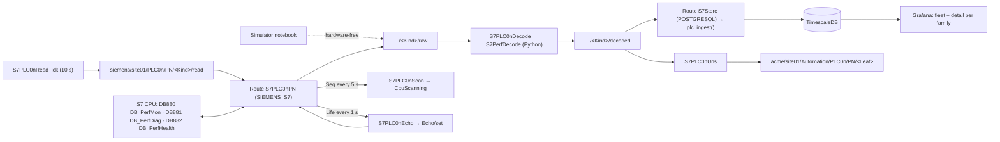

# siemens-s7-plc-health

Health, cycle-time metrics and diagnostics from Siemens S7 PLCs, read into Coreflux with the native `SIEMENS_S7`
connector, stored in TimescaleDB and shown in Grafana. A small set of blocks in the PLC measures every cycle, counts
every error-OB call and closes one record a second. The broker reads those records whole, so nothing is lost between two
polls, and the PLC writes a health counter that the broker echoes back on each path.

**Status:** the PLC side runs on a real S7-300 and on a real S7-1500 (firmware V2.6), each read by a Coreflux 2.22
broker into a database and dashboards. The broker side here is verified on a fresh **Coreflux 2.22.0** broker against
two mock PLCs that speak S7 and a real TimescaleDB ([`VERIFICATION.md`](VERIFICATION.md): 47 cells, 58 checks, no runtime error). It
**requires Coreflux 2.22 or newer** and fits the **Community** licence, one PLC per family (below).

One template, one folder per PLC family. What the broker reads is the same on every family: the cycle records
(`DB_PerfMon`, byte-identical), the health loop (`DB_PerfHealth`) and a diagnostics block (`DB_PerfDiag`) whose header
names its family. The PLC code differs, because each family reads its diagnostics differently, and so do the notebooks.

| Folder | Family | Status |
|---|---|---|
| [`s7-300/`](s7-300/TIA-PROJECT.md) | S7-300, and the S7-400 by the same rules | runs on a CPU 315-2 PN/DP, read over MPI and PN at once |
| [`s7-1500/`](s7-1500/TIA-PROJECT.md) | S7-1500 | runs on a CPU 1511-1 PN, firmware V2.6, added to a project that already ran a program; read over PN |

Each folder holds `TIA-PROJECT.md`, the one guide from the IP address to the first read, and `plc/`, the blocks as a TIA
external source.

## What the blocks give, by family

| | S7-300 | S7-1500 |
|---|---|---|
| Cycle time: min, max and average per second, and a histogram | `OB1_PREV_CYCLE` | `RUNTIME`, in the kit's own program-cycle OB |
| Communication load | not available | `RT_INFO` |
| Error OBs: counted, with the last start information | OB80, OB82, OB86 | OB80, OB82, OB83, OB86, OB121, OB122, each with S7-1500 or classic (S7-300/400 style) start information |
| Identity | SZL `0111`, `011C` | from the reader's configuration (`Get_IM_Data` is not in TIA V15.1 for FW V2.x) |
| LEDs | SZL `0074` | `LED` |
| Diagnostic buffer | the newest 10 entries, SZL `00A0` | not readable from the program on this family |
| Boot stamp, and the previous boot's counters | OB100 | the kit's own startup OB |
| Health loop, one byte written back per path | yes | yes |

**Firmware.** The S7-1500 blocks need nothing newer than firmware V2.x and no licence. That matters because monitoring
through the S7-1500 Web API starts at firmware V2.8, with the diagnostic buffer from V3.1 and the runtime figures from
V4.1, so it cannot see the many CPUs still running older firmware.

**Why count in the PLC.** A buffer only holds what fits. On the S7-1500 bench, an existing program accessing I/O that
was not wired filled the whole diagnostic buffer, about 1,000 entries, in under half a second, and a power cut a few
minutes later left no trace in it. A counter per error OB, with the last start information, survives that.

## What you will see

- `acme/site01/Automation/PLC01/PN/CycleAvg` → `{"value":0.48,"timestamp":"2026-11-03T12:00:02.000Z","datatype":"number","status":"Good","units":"ms"}`,
  stamped with the PLC's own time of the record, and the same for `CycleMin`, `CycleMax`, `CommLoad`, the error-OB
  counts, `BootTime`, `ReadDuration` and `ClockSkew`.
- `LastDiagEvent` on an S7-300: the newest diagnostic-buffer entry with Siemens' text, `0x4302, Mode transition from
  STARTUP to RUN`; after a restart the entry before it names the STOP's cause.
- `LastFault` on an S7-1500: the newest error-OB call in Siemens' words, `OB122, fault id 0x42 I/O access error,
  reading, FC 72, area 0x01 Direct (peripheral) access to inputs, 420 calls since the boot`, whichever form of start
  information the OB has.
- Three verdicts per path, from the broker: `CpuScanning` (false within about 10 s of a STOP, while the path stays
  online), `Health` (`ok`, `stalled`, `corrupt`, `unknown`) and `DeviceStatus` (`online`, `stale`, `offline`).
- In TimescaleDB: every one-second record once, whichever path delivered it first; every read with its duration and
  what it refused; every verdict change; every error-OB call and buffer entry with its text; `plc_latest`, the fleet
  in one row per PLC.
- In Grafana: the fleet, and one detail page per family (below).

## Architecture

## Included notebooks

| Notebook | Purpose | When to run |
|---|---|---|
| `siemens-s7-plc-health-s7-300.lotnb` | PLC01, an S7-300 over PN: the decoder, the S7 route, the store route, six actions; the second path (MPI) and the Rule as documented sections | an S7-300 or S7-400 |
| `siemens-s7-plc-health-s7-1500.lotnb` | PLC02, an S7-1500 over PN: the same decoder and store route, its route, six actions; the Rule as a documented section | an S7-1500 |
| `siemens-s7-plc-health-simulator.lotnb` | both example PLCs simulated byte for byte, answering the routes' read topics; STOP and RUN from a topic | hardware-free, instead of the Route cells |

The decoder cell (`S7PerfDecode`) and the store route (`S7Store`) are the same in both family notebooks, so the two can
run on one broker. **The Rule is not a cell:** on 2.22.0 Community, `-addRule` is refused ("RBAC / Topic Access Control
rules require a Growth or Enterprise license", measured), so each family notebook documents it for those licences. Broker **2.22 or newer**: the actions publish retained leaves with `PUBLISH … RETAIN`
and read `GET JSON` from a Python return value.

**Licence, measured on 2.22.0 Community** (3 connectors, 24 actions; every `ADD EVENT` of a route and a writable tag
count as actions, and so does a Python script):

- Either family notebook alone: **2 connectors of 3, 12 actions of 24** (6 actions, 5 route events: three reads and the
  writable tag of the S7 route and the store route's one, 1 Python script).
- Both family notebooks on one broker: **3 of 3, 22 of 24**.
- The S7-300 notebook with its second path: **3 of 3, 16 of 24**, alone. Next to the S7-1500 notebook it is a fourth
  connector, which Community refuses ("Maximum allowed connectors are 3").
- Without a PLC: a family notebook without its Route cell plus the simulator, 1 connector and 12 actions; both families
  and the simulator, 1 connector and 18 actions.
- The documented Rule: refused on Community (Rules need Growth or Enterprise).
- **Keep headroom under the 24 actions.** Measured on 2.22.0 Community: after an action is removed (`-removeAction`), the
  broker's usage figure no longer counts the route events, and it then accepts more actions than the tier allows. At its
  next restart it loads the actions and skips every route, so nothing is read from the PLC any more; only the broker log
  says so. If you delete and add actions next to these notebooks, restart the broker and read its usage (`/license` on the
  ops port) before you rely on it. Reported to Coreflux. The figures above were each measured on a fresh broker.

A second PLC of either family is one more connector and 10 more actions (its route, six actions): beyond Community.

## Infrastructure and assets

| Path | What |
|---|---|
| `s7-300/`, `s7-1500/` | the PLC side: the blocks (`plc/perf_kit.scl`) and the guide (`TIA-PROJECT.md`) per family |
| `sql/` | the historian: schema, fleet functions, Siemens' texts as CSV and generated SQL, the two roles ([`sql/README.md`](sql/README.md)) |
| `grafana/provisioning/` | the datasource (uid `timescale-edge`), the fleet and detail dashboards, the alert rules |
| `compose/docker-compose.yml` | broker 2.22.0, Hub 2.12.0, TimescaleDB (`timescale/timescaledb-ha:pg17.11-ts2.30.1`, the SQL applied on first start), Grafana 13.2.0, and two mock PLCs (profile `mock`); every port on `127.0.0.1` |
| `compose/broker-config.json` | forced on every start: anonymous login **off**, durability **on** |
| `compose/.env.example` | the secret-store key, the database and role passwords, Grafana's admin password, the ports |
| `compose/mock-plc/` | the mock PLC: a python-snap7 server holding the kit's DBs and running its algorithm (`--family s7-300` or `s7-1500`) |
| `VERIFICATION.md` | what was proved, on which broker version |
| `GALLERY.md` | the entry on templates.coreflux.org |

## Topic and data dictionary

| Topic | Payload | Produced by |
|---|---|---|
| `siemens/site01/<PLC>/<path>/<Kind>/read` | `go`; `<Kind>` = `PerfMon`, `PerfDiag`, `PerfHealth` | the read tick |
| `siemens/site01/<PLC>/<path>/<Kind>/raw` | the connector's answer, `{"success":true,"count":2058,"data":{"value_0":131140,…}}` | the S7 route (or the simulator) |
| `siemens/site01/<PLC>/<path>/<Kind>/decoded` | one JSON message per read: records, the read contract's refusals by reason, the DB's state | the decode action |
| `siemens/site01/<PLC>/<path>/Transition/decoded` | `{"kind":"Transition","signal":"CpuScanning","value":"false","prev":"true","at":"…"}` | the verdict actions |
| `siemens/site01/<PLC>/<path>/PerfMon/Seq` | the record counter, every 5 s | the S7 route |
| `siemens/site01/<PLC>/<path>/PerfHealth/Life` · `Echo` · `Echo/set` | one byte each way | the S7 route · the echo action |
| `acme/site01/Automation/<PLC>/<path>/<Leaf>` | retained envelope | the UNS, scan and liveness actions |
| `acme/site01/Automation/<PLC>/<path>/_asset` | retained: model, order number, route, endpoint, every leaf with its units and cadence | the liveness action |
| `siemens/site01/_sim/<PLC>/mode` | `STOP` or `RUN`, retained | you, with the simulator |

| Leaf | Units | S7-300 | S7-1500 | What |
|---|---|---|---|---|
| `CycleMin`, `CycleAvg`, `CycleMax` | ms | yes | yes | the newest one-second record |
| `CommLoad` | % | -1, status `Bad` | yes | communication load, `RT_INFO` |
| `OB80Events`, `OB82Events`, `OB86Events` | 1 | yes | yes | calls since the boot |
| `OB83Events`, `OB121Events`, `OB122Events` | 1 | | yes | calls since the boot |
| `LastFault` | | the fault an error OB recorded | the newest call of any error OB, in words | |
| `LastDiagEvent` | | yes | | the newest diagnostic-buffer entry, with Siemens' text |
| `BootTime` | | yes | yes | the last start to RUN |
| `ReadDuration` | ms | yes | yes | the last whole read of `DB_PerfMon` |
| `ClockSkew` | s | yes | yes | the broker's time minus the newest record's stamp |
| `CpuScanning` | | yes | yes | false once `Seq` has not moved for 10 s |
| `Health` | | yes | yes | the health loop: `ok`, `stalled`, `corrupt` (held 300 s), `unknown` while not scanning |
| `DeviceStatus` | | yes | yes | `online` up to 20 s since the last good read or heartbeat, `stale` up to 90 s, `offline` |

**The envelope:** `value` (its JSON type matches `datatype`), `timestamp` (ISO-8601 UTC: the PLC's stamp for what the PLC
records, the broker's time for what the broker derives), `datatype` (`number` · `boolean` · `string`), `status`
(`Good`, `Uncertain` for a clock skew while the CPU is not scanning, `Bad` for a value the PLC does not have), `units`
(numeric leaves only).

## Quick start

**A] With no hardware, from the gallery.** On a broker 2.22 or newer: deploy a family notebook (or both) **without the
Route cell**, then `siemens-s7-plc-health-simulator.lotnb`. The UNS fills within 30 s. Publish `STOP` (retained) to
`siemens/site01/_sim/PLC01/mode` and watch `CpuScanning` and `Health`. Without a historian the store route only logs
that it cannot connect.

**B] With no hardware, the whole stack.** `cd compose && cp .env.example .env`, fill in every value (each secret has its
generator above it), `docker compose --profile mock up -d`. In the Hub (http://localhost:3000, connection host
`coreflux-broker`), set the ENV `TIMESCALE_HOST=timescaledb`, `TIMESCALE_DB=plc`, `TIMESCALE_USER=uns_writer` and the
SECRET `TIMESCALE_PASSWORD` (your `UNS_WRITER_PASSWORD`). Deploy both family notebooks with the route addresses changed
to `mock-plc-s7-300` and `mock-plc-s7-1500`. Grafana is on http://localhost:3001. `docker compose exec mock-plc-s7-300
touch /tmp/kit-stop` puts a mock into STOP; `rm /tmp/kit-stop` back to RUN.

**C] With your PLC.** The PLC side first: the family's `TIA-PROJECT.md`, from the IP address to the first read. Then the
historian (`sql/`, or the compose stack without the `mock` profile), the broker's ENV and SECRET as above, and the
family notebook with your CPU's address in its route. "How to verify" at the end of each notebook lists what to expect.

## How it works

**The whole ring, every 30 s.** The kit closes one 68-byte record a second into a ring of 120 in `DB_PerfMon`. The route
reads the whole DB in one request (2,058 DWORDs), every 30 s per DB and path, so an outage of up to 90 s loses nothing.

**The read contract.** A read spans many CPU cycles while the ring moves on, so it is not atomic; the header is read
first, so everything in it is older than the records. The decoder accepts a record only when its number is not newer
than the header's, it sits in the slot its number belongs to, it is not about to be overwritten during the read, and its
stamp is a date; everything else is counted by reason (`plc_read.rej_*`). The kit keeps the ring over a warm restart,
and the same rules refuse the previous boot's records. Decoding is stateless and the database dedupes, so a broker
restart is safe.

**Facts and evidence apart.** `plc_ingest()` stores every record once (`plc_cycle`) and, per path, when it first arrived
and its content hash (`plc_arrival`): two paths can be compared byte for byte without doubling a single roll-up.

**The health loop.** The PLC shows a `Life` byte per path; the broker writes it straight back as `Echo`; the PLC moves
`Life` on only when it sees its own value return. The circle is PLC → broker → PLC, so a broken write path, a dead
action or a second writer each show, although the reads look healthy: `stalled` after 5 s without a confirmation,
`corrupt` when a value that is neither the current nor the previous one comes back.

**STOP from outside.** In STOP the DBs stay readable and frozen. `Seq` not moving for 10 s while the route still answers
is `CpuScanning` false, with the path `online`: the CPU is not scanning, and the network is fine. Values the program
writes, the LEDs among them, are then the last ones of RUN and are not shown as current.

**The verdicts in the historian.** Every change of `CpuScanning`, `Health` and `DeviceStatus` also goes to
`plc_state_change`, by the broker's clock: the dashboards show the broker's own answer, the same as the Hub.

## The second path (S7-300)

An S7-300 can be read over its PN port and, at the same time, over its MPI interface through an Ethernet gateway (an
ACCON-NetLink in addressed mode was measured). Both paths read the same DBs, and the historian keeps each fact once with
the evidence of each path, so a fault can be located:

| MPI | PN | `Seq` | Meaning |
|---|---|---|---|
| ok | ok | moving | healthy |
| down | ok | moving | the gateway or the MPI bus |
| ok | down | moving | the PN port or its switch |
| down | down | unknown | the CPU's power, the shared LAN, or the broker's side |
| ok | any | frozen | the CPU is not scanning (STOP or HALT), with the cause from the diagnostic buffer |

The S7-300 notebook's last section adds it in three steps: two lines in the decoder's `PLCS`, the route `S7PLC01MPI`,
and the registry's `paths`. It is documented there and not a cell, because it is a third connector: the S7-300 notebook
with it fits Community alone, but not next to the S7-1500 notebook (a fourth connector, refused). The harness applies the
section exactly as written and checks that both paths deliver the same records.

## Dashboards

Grafana opens on the **PLC fleet**: every PLC, worst first, with its state, paths, health loop and cycle against its own
watchdog, built for a site of some 50 PLCs. A click on a PLC opens the **detail page of its family** (S7-300 or S7-1500),
which holds only what that family has: the diagnostic buffer with Siemens' texts on an S7-300, the error OBs with their
meaning, the LEDs and `RT_INFO` on an S7-1500, then the boots, the health loop, the cycle and the reads per path. Nine
alert rules per family show their state on the pages; as shipped, nothing is sent.

The tree in `grafana/provisioning/` is provisioned by the quick-start stack. Its datasource, uid `timescale-edge`, reads
the historian as `grafana_reader`, with the connection from the container's environment (`TIMESCALE_HOST`,
`TIMESCALE_DB`, `GRAFANA_READER_USER`, `GRAFANA_READER_PASSWORD`). Tested on Grafana 13.2.0. The pages, the alerts, how
to be notified and how to mount the tree into your own Grafana: [`grafana/README.md`](grafana/README.md).

## Production readiness

- **The OT network.** S7 (PUT/GET) has no authentication: anyone who reaches port 102 can read and write the CPU's DBs.
  Run the broker on the OT side and never route port 102 from an office network.
- **The Rule needs Growth or Enterprise.** On such a broker the accounts and the Rule exist before any client connects.
  On Community there is no topic fence: give applications no broker account they do not need.
- **Licence.** One PLC per family on Community; more PLCs, or the S7-300's second path next to an S7-1500, need a
  licence with more connectors (Growth: 5 connectors, 100 actions).
- **The PLC's clock.** Records are stamped by the CPU. A CPU clock that was never set stamps its first boots in the past;
  serve it time (NTP) and watch `ClockSkew`.
- **The cost in the PLC.** About 0.1 ms per error-OB call on a CPU 1511 (an OB122 flood of 1,900 calls a second raised
  the cycle from 19.8 ms to 24.9 ms); negligible in a healthy program.
- **Back up** the broker volume (secret store, durability) and the database; pin `COREFLUX_SECRET_KEY`.
- **Retention** is set in `schema.sql`: 180 days raw, then the roll-ups; about 1 GB per PLC in steady state.

## Adapting this template

- **Your addresses and ids:** the route's `IP`, `RACK`/`SLOT`, the DB numbers if you chose others in TIA; in the decoder's
  `PLCS` the `plc_id`, model, order number and endpoint; the same `plc_id` in `plc_registry`. Keep the decoder cell equal
  in both notebooks if you run both.
- **Your UNS root:** replace `acme/site01` everywhere, and `siemens/site01` for the raw plane.
- **More PLCs:** per PLC one route per path (the family's notebook route with its address), the six actions with the PLC
  key changed in their topics and their trailing `"PLC0n"`, one entry in `PLCS`, one row in `plc_registry`. The decoder,
  the store route and the Rule are shared.
- **Another reading interval:** the read tick and `read_s` in `PLCS` together. Keep a DB read well inside the ring's
  120 s.

## Security notes

- The raw plane (`siemens/#`) writes into the PLC: `…/Echo/set` goes into `DB_PerfHealth`, `…/read` makes the route read.
  The Rule `S7RawPlanePublish` (Growth or Enterprise; Community refuses Rules) admits only root and the broker's own
  identity, the empty user name, which is why anonymous login must stay off. On Community any account can publish there;
  what it can do is bounded by the route: write the one `Echo` byte (the health loop then shows `corrupt`) or cause a read.
- The store route's password is a broker SECRET (`TIMESCALE_PASSWORD`), never in a notebook.
- `uns_writer` can only INSERT (and read `plc_registry`): a stolen broker credential cannot rewrite the history.
  `grafana_reader` can only read.
- Never commit `compose/.env`.

## Measured on the S7-300

A CPU 315-2 PN/DP with a 240-byte PDU, through the `SIEMENS_S7` connector on a Coreflux 2.22 broker. The CPU ran only
these blocks, with no I/O cards or remote I/O connected.

| Read | MPI at 187.5 kbit/s, through an ACCON-NetLink | PN |
|---|---|---|
| `DB_PerfMon`, 8,232 bytes | **1.5 s** | **0.3 s** |
| `DB_PerfDiag`, 644 bytes | 0.12 s | 0.02 s |

- **Both paths deliver the same bytes:** no record differed in either of two runs, with 92 and 22 records present in both reads.
- **The cycle with these blocks:** about 2,080 cycles a second, 0.48 ms on average, 2 ms at most. There is no figure yet for this CPU without them.
- **These are from a CPU running almost nothing.** The same CPU ran a real application at around 40 ms a cycle. A CPU serves communication between its other work, so expect longer reads on a loaded one, and measure on yours.
- **A read is not atomic.** One read spans many CPU scans, and a read does find records newer than the header it read first. The decoder allows for that, and refuses those until the next read.

## Measured on the S7-1500

A CPU 1511-1 PN, firmware V2.6, engineered in TIA Portal V15.1. The kit was added to a project migrated from an S7-300 that already ran a program, with its I/O configured but not wired. Read over PN with PUT/GET, through the `SIEMENS_S7` connector on a Coreflux 2.22 broker.

- **The kit goes into an existing program without touching it.** Its own program-cycle OB and startup OB, and one call at the end of each error OB the project has. The source generates without errors in TIA V15.1.
- **A whole `DB_PerfMon`, 8,232 bytes, reads in about 0.02 s** over PN with a 480-byte PDU (a direct S7 read; `DB_PerfDiag`, 324 bytes, in about 1 ms).
- **The cycle:** about 20 ms with the existing program, 40 to 50 cycles a second, communication load 6 %.
- **Error OBs called all the time are counted, at a price.** The existing program caused about 1,900 OB122 calls a second. The kit counted all of them, over 56 million in eight hours, with the block and address of the last one. The average cycle rose from 19.8 ms to 24.9 ms, about 0.1 ms a call.
- **Both forms of start information end in the same record.** In a migrated project some error OBs keep the classic S7-300/400 start information and are written in STL. The guide gives the call for each form and language, and a reader tells the form from one bit of the record.
- **STOP is seen from outside.** The DBs stay readable, the record counter stands still, and the broker reports the CPU as not scanning about 10 s later. The values the program wrote, the LEDs among them, are then the last ones of RUN: a reader must not show them as current.
- **The program cannot read the diagnostic buffer on this family, and this CPU refuses it to an outside S7 reader too.** The error-OB records are what the kit offers in its place.

Not yet exercised on this CPU: the records of OB80, OB82, OB83, OB86 and OB121 (no such event on the bench so far), and the module states.

## Field notes

- **PUT/GET is hardware configuration** on an S7-1500: a download in RUN does not load it, and every read is refused
  (`0x8104`) until the hardware is downloaded, which stops the CPU.
- **A startup OB created as "Program cycle" runs every cycle** and nothing warns: the restart count ran to 32,767. The
  kit's guide says how to create its two OBs with their kinds.
- **TIA Portal V15.1 reads an external source with LF line endings as STL.** The sources here are CRLF; keep them so.
- **The meanings of Siemens' codes are reproduced, not all confirmed on a CPU** ([`sql/README.md`](sql/README.md)): a
  code that disagrees with what your CPU did is welcome as a pull request.
