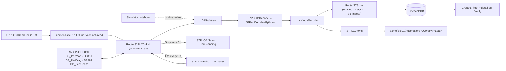

# siemens-s7-plc-health

**Know how your Siemens PLCs are doing: cycle time, error OBs, STOPs and a live health loop, read into Coreflux and kept
in a database, with nothing lost between two polls.**

A small, self-contained set of blocks goes into the PLC next to the program it already runs. It measures every cycle,
counts every error-OB call and closes one record a second into a ring. The broker reads the ring whole with the native
`SIEMENS_S7` connector, decodes it, publishes a UNS, stores every record once in TimescaleDB, and Grafana shows the fleet.

- **Nothing is lost between polls.** The PLC keeps two minutes of one-second records; a read every 30 s picks them all up.
- **The PLC counts what a buffer forgets.** Every error-OB call is counted with its last start information, even 2,000 a
  second, which overwrite a diagnostic buffer in half a second.
- **A STOP is seen from outside,** while the network is fine, and told apart from a lost PLC.
- **A health loop proves the whole path,** PLC → broker → PLC, not only that reads answer.
- **The program stays as it is.** The kit adds its own calls and blocks, never a change to the program's code.

**Needs:** Coreflux **2.22 or newer**. One PLC per family fits the **Community** licence. TimescaleDB and Grafana are
optional; a compose stack with both, and two mock PLCs, is included. Verified on a fresh Coreflux 2.22.0 broker against
mock PLCs and a real TimescaleDB ([`VERIFICATION.md`](VERIFICATION.md): 47 cells, 58 checks, no runtime error).

## Families

One template, one folder per PLC family. The broker reads the same three DBs on every family; the PLC code differs,
because each family reaches its diagnostics differently.

| Folder | Family | Status |
|---|---|---|
| [`s7-300/`](s7-300/TIA-PROJECT.md) | S7-300, and the S7-400 by the same rules | runs on a CPU 315-2 PN/DP, read over MPI and PN at once |
| [`s7-1500/`](s7-1500/TIA-PROJECT.md) | S7-1500 | runs on a CPU 1511-1 PN (firmware V2.6) added to an existing project, read over PN; also on a simulated CPU 1516-3 PN/DP (firmware V4.1) |
| [`s7-1200/`](s7-1200/TIA-PROJECT.md) | S7-1200 | runs on a simulated CPU 1214C G2 (firmware V4.1), read over PN; not yet on a first-generation CPU. Its DBs read like the S7-1500's |

Each folder holds `TIA-PROJECT.md`, one guide from the IP address to the first read, and `plc/`, the blocks as a TIA
external source.

## Try it

**A] No hardware, in the broker only.** On a broker 2.22 or newer, deploy a family notebook **without its Route cell**,
then `siemens-s7-plc-health-simulator.lotnb`. The UNS fills within 30 s. Publish `STOP` (retained) to
`siemens/site01/_sim/PLC01/mode` and watch `CpuScanning` and `Health` change.

**B] No hardware, the whole stack.**

```bash
cd compose && cp .env.example .env        # fill in every value; each secret has its generator above it
docker compose --profile mock up -d
```

In the Hub (http://localhost:3000, connection host `coreflux-broker`) set the ENV `TIMESCALE_HOST=timescaledb`,
`TIMESCALE_DB=plc`, `TIMESCALE_USER=uns_writer` and the SECRET `TIMESCALE_PASSWORD` (your `UNS_WRITER_PASSWORD`). Deploy
both family notebooks with the route addresses changed to `mock-plc-s7-300` and `mock-plc-s7-1500`. Grafana is on
http://localhost:3001. `docker compose exec mock-plc-s7-300 touch /tmp/kit-stop` puts a mock into STOP; `rm /tmp/kit-stop`
brings it back.

**C] Your PLC.** The PLC side first: your family's `TIA-PROJECT.md`. Then the historian (`sql/`, or the compose stack
without the `mock` profile), the broker's ENV and SECRET as above, and the family notebook with your CPU's address in its
route. *How to verify* at the end of each notebook lists what to expect.

## What the PLC gives, by family

| | S7-300 | S7-1200 | S7-1500 |
|---|---|---|---|
| Cycle time: min, max, average per second, histogram | `OB1_PREV_CYCLE` | `RUNTIME`, in the kit's own cycle OB | `RUNTIME`, in the kit's own cycle OB |
| Communication load | – | – (no `RT_INFO`) | `RT_INFO` |
| Error OBs, counted with the last start information | OB80, OB82, OB86 | OB80, OB82, OB83, OB86 | OB80, OB82, OB83, OB86, OB121, OB122; S7-1500 or classic start information |
| Identity | SZL `0111`, `011C` | from the reader's configuration | from the reader's configuration |
| LEDs | SZL `0074` | `LED` | `LED` |
| Diagnostic buffer | the newest 10 entries, SZL `00A0` | – (not readable from the program) | – (not readable from the program) |
| Boot stamp and the previous boot's counters | OB100 | the kit's own startup OB | the kit's own startup OB |
| Health loop, one byte written back per path | yes | yes | yes |

**Why count in the PLC.** A diagnostic buffer holds only what fits. On the S7-1500 bench a program accessing I/O that was
not wired filled all of it, about 1,000 entries, in under half a second; a power cut a few minutes later left no trace. A
counter per error OB survives that.

**Why no newer firmware is needed.** The S7-1500 blocks need firmware V2.x and no licence. Monitoring through the S7-1500
Web API starts at V2.8 (the diagnostic buffer from V3.1), so it cannot see the many CPUs on older firmware.

## What you will see

- **A UNS per PLC and path**, each leaf a retained envelope stamped with the PLC's own time:
  `acme/site01/Automation/PLC01/PN/CycleAvg` →
  `{"value":0.48,"timestamp":"2026-11-03T12:00:02.000Z","datatype":"number","status":"Good","units":"ms"}`.
- **Three verdicts per path:** `CpuScanning` (false within about 20 s of a STOP, while the path stays online), `Health`
  (`ok`, `stalled`, `corrupt`, `unknown`) and `DeviceStatus` (`online`, `stale`, `offline`).
- **The newest fault in words:** `LastFault` on an S7-1200 or S7-1500, for example `OB122, fault id 0x42 I/O access
  error, reading, FC 72 … 420 calls since the boot`; `LastDiagEvent` on an S7-300, the newest buffer entry with
  Siemens' text.
- **In TimescaleDB:** every one-second record once, every read with its duration, every verdict change, every error-OB
  call and buffer entry with its text, and `plc_latest`, the fleet in one row per PLC.
- **In Grafana:** the fleet, worst first, and one detail page per family.



## How it works

- **The whole ring, every 30 s.** The kit closes one 68-byte record a second into a ring of 120 in `DB_PerfMon`. The
  route reads the whole DB in one request (2,058 DWORDs), so an outage of up to 90 s loses nothing.
- **The read contract.** A read spans many CPU cycles while the ring moves on. The header is read first, so the decoder
  accepts a record only when it is not newer than the header, sits in the slot its number belongs to, is not about to
  be overwritten, and carries a valid stamp. Everything else is counted by reason (`plc_read.rej_*`).
- **A restart between two reads.** The ring survives a warm restart or a power loss. The slots the new boot has not yet
  overwritten are offered as the previous boot's, and the historian files them under that boot where they continue its
  records, one a second, up to its last record number. A record the new boot overwrote before the first read after the
  restart is lost, and shows as a gap.
- **Stateless decoding, deduplicating storage.** Every read offers everything valid; `plc_ingest()` stores each record
  once (`plc_cycle`) and, per path, when it arrived and its hash (`plc_arrival`). A broker restart is safe, and two paths
  can be compared byte for byte.
- **The health loop.** The PLC shows a `Life` byte per path, the broker writes it straight back as `Echo`, and the PLC
  moves `Life` on only when its own value returns. A broken write path, a dead action or a second writer each show:
  `stalled` after 5 s without a confirmation, `corrupt` when a foreign value comes back.
- **STOP from outside.** In STOP the DBs stay readable and frozen. `Seq` standing still while the route answers is
  `CpuScanning` false, with the path `online`. Values the program writes, the LEDs among them, are then the last ones of
  RUN and are not shown as current.
- **A PLC registers itself.** Its entry in the decoder's `PLCS` is the one place a PLC is described. Once a minute it is
  published and stored in `plc_registry` (never overwritten), so a new PLC of a known family appears in the fleet
  without a database or Grafana change.

## Reference

<details>
<summary><b>Notebooks, and what fits the Community licence</b></summary>

| Notebook | Purpose | When to run |
|---|---|---|
| `siemens-s7-plc-health-s7-300.lotnb` | PLC01, an S7-300 over PN: the decoder, the S7 route, the store route, six actions; the second path (MPI) and the Rule as documented sections | an S7-300 or S7-400 |
| `siemens-s7-plc-health-s7-1500.lotnb` | PLC02, an S7-1500 over PN: the same decoder and store route, its route, six actions; the Rule as a documented section | an S7-1500, or an S7-1200 with three changes (below) |
| `siemens-s7-plc-health-simulator.lotnb` | both example PLCs simulated byte for byte, answering the routes' read topics; STOP and RUN from a topic | hardware-free, instead of the Route cells |

The decoder cell (`S7PerfDecode`) and the store route (`S7Store`) are the same in both family notebooks, so both can run
on one broker. **The Rule is not a cell:** on 2.22.0 Community `-addRule` is refused ("RBAC / Topic Access Control rules
require a Growth or Enterprise license", measured), so each notebook documents it for those licences.

**An S7-1200** (measured on the simulated G2) uses the S7-1500 notebook with three changes: the route's `CPU_TYPE` is
`"S71200"`; its `PLCS` entry has `"family": "s7-1200"` and its own model; the `Uns` action leaves out the OB121 and
OB122 leaves. Without `RT_INFO` there is no communication load: the decoder publishes -1 and the detail page leaves the
tile out.

**Licence, measured on 2.22.0 Community** (3 connectors, 24 actions; each `ADD EVENT` of a route, a writable tag and a
Python script count as actions):

- Either family notebook alone: **2 connectors of 3, 12 actions of 24**.
- Both family notebooks on one broker: **3 of 3, 22 of 24**.
- The S7-300 notebook with its second path: **3 of 3, 16 of 24**, alone; next to the S7-1500 notebook it is a fourth
  connector, which Community refuses.
- Without a PLC: a family notebook without its Route cell plus the simulator, 1 connector and 12 actions; both families
  and the simulator, 1 connector and 18 actions.
- A second PLC of either family is one more connector and 10 more actions: beyond Community.
- **Keep headroom under the 24 actions.** Measured on 2.22.0 Community: after `-removeAction` the broker's usage figure
  stops counting route events and accepts more actions than the tier allows; at its next restart it skips every route,
  and only the broker log says so. After deleting and adding actions, restart the broker and read `/license` on the ops
  port before relying on it. Reported to Coreflux.

</details>

<details>
<summary><b>Topic and data dictionary</b></summary>

| Topic | Payload | Produced by |
|---|---|---|
| `siemens/site01/<PLC>/<path>/<Kind>/read` | `go`; `<Kind>` = `PerfMon`, `PerfDiag`, `PerfHealth` | the read tick |
| `siemens/site01/<PLC>/<path>/<Kind>/raw` | the connector's answer, `{"success":true,"count":2058,"data":{"value_0":131140,…}}` | the S7 route (or the simulator) |
| `siemens/site01/<PLC>/<path>/<Kind>/decoded` | one JSON message per read: records, the previous boot's records (`earlier`), refusals by reason, the DB's state | the decode action |
| `siemens/site01/<PLC>/<path>/Transition/decoded` | `{"kind":"Transition","signal":"CpuScanning","value":"false","prev":"true","at":"…"}` | the verdict actions |
| `siemens/site01/<PLC>/<path>/PerfMon/Seq` | the record counter, every 5 s | the S7 route |
| `siemens/site01/<PLC>/<path>/PerfHealth/Life` · `Echo` · `Echo/set` | one byte each way | the S7 route · the echo action |
| `acme/site01/Automation/<PLC>/<path>/<Leaf>` | retained envelope | the UNS, scan and liveness actions |
| `acme/site01/Automation/<PLC>/<path>/_asset` | retained: model, order number, route, endpoint, every leaf with its units and cadence | the liveness action |
| `siemens/site01/_sim/<PLC>/mode` | `STOP` or `RUN`, retained | you, with the simulator |

| Leaf | Units | S7-300 | S7-1200 | S7-1500 | What |
|---|---|---|---|---|---|
| `CycleMin`, `CycleAvg`, `CycleMax` | ms | yes | yes | yes | the newest one-second record |
| `CommLoad` | % | -1, status `Bad` | -1, status `Bad` | yes | communication load, `RT_INFO` |
| `OB80Events`, `OB82Events`, `OB86Events` | 1 | yes | yes | yes | calls since the boot |
| `OB83Events` | 1 | | yes | yes | calls since the boot |
| `OB121Events`, `OB122Events` | 1 | | | yes | calls since the boot |
| `LastFault` | | the fault an error OB recorded | the newest call of any error OB, in words | the newest call of any error OB, in words | |
| `LastDiagEvent` | | yes | | | the newest diagnostic-buffer entry, with Siemens' text |
| `BootTime` | | yes | yes | yes | the last start to RUN |
| `ReadDuration` | ms | yes | yes | yes | the last whole read of `DB_PerfMon` |
| `ClockSkew` | s | yes | yes | yes | the broker's time minus the newest record's stamp |
| `CpuScanning` | | yes | yes | yes | false once `Seq` has not moved for 10 s |
| `Health` | | yes | yes | yes | the health loop: `ok`, `stalled`, `corrupt` (held 300 s), `unknown` while not scanning |
| `DeviceStatus` | | yes | yes | yes | `online` up to 20 s since the last good read or heartbeat, `stale` up to 90 s, `offline` |

**The envelope:** `value` (its JSON type matches `datatype`), `timestamp` (ISO-8601 UTC: the PLC's stamp for what the PLC
records, the broker's time for what the broker derives), `datatype` (`number` · `boolean` · `string`), `status`
(`Good`, `Uncertain` for a clock skew while the CPU is not scanning, `Bad` for a value the PLC does not have), `units`
(numeric leaves only).

</details>

<details>
<summary><b>Files in this folder</b></summary>

| Path | What |
|---|---|
| `s7-300/`, `s7-1200/`, `s7-1500/` | the PLC side per family: the blocks (`plc/perf_kit.scl`) and the guide (`TIA-PROJECT.md`) |
| `src/*.lotnb.md` | the notebooks as authored; the `.lotnb` files are rendered from them |
| `sql/` | the historian: schema, fleet functions, Siemens' texts as CSV and generated SQL, the two roles ([`sql/README.md`](sql/README.md)) |
| `grafana/provisioning/` | the datasource (uid `timescale-edge`), the fleet and detail dashboards, the alert rules ([`grafana/README.md`](grafana/README.md)) |
| `compose/docker-compose.yml` | broker 2.22.0, Hub 2.12.0, TimescaleDB (`timescale/timescaledb-ha:pg17.11-ts2.30.1`, the SQL applied on first start), Grafana 13.2.0, and two mock PLCs (profile `mock`); every port on `127.0.0.1` |
| `compose/broker-config.json` | forced on every start: anonymous login **off**, durability **on** |
| `compose/.env.example` | the secret-store key, the database and role passwords, Grafana's admin password, the ports |
| `compose/mock-plc/` | the mock PLC: a python-snap7 server holding the kit's DBs and running its algorithm |
| `VERIFICATION.md` | what was proved, on which broker version |
| `GALLERY.md` | the entry on templates.coreflux.org |

</details>

<details>
<summary><b>The second path (S7-300)</b></summary>

An S7-300 can be read over its PN port and, at the same time, over MPI through an Ethernet gateway (an ACCON-NetLink in
addressed mode was measured). Both paths read the same DBs, and the historian keeps each fact once with the evidence of
each path, so a fault can be located:

| MPI | PN | `Seq` | Meaning |
|---|---|---|---|
| ok | ok | moving | healthy |
| down | ok | moving | the gateway or the MPI bus |
| ok | down | moving | the PN port or its switch |
| down | down | unknown | the CPU's power, the shared LAN, or the broker's side |
| ok | any | frozen | the CPU is not scanning (STOP or HALT), with the cause from the diagnostic buffer |

The S7-300 notebook's last section adds it in three steps: two lines in the decoder's `PLCS`, the route `S7PLC01MPI`, and
the registry's `paths`. It is documented, not a cell, because it is a third connector (see the licence above).

</details>

<details>
<summary><b>Dashboards</b></summary>

Grafana opens on the **PLC fleet**: every PLC, worst first, with its state, paths, health loop and cycle against its own
watchdog, built for a site of some 50 PLCs. A click opens the **detail page of its family**, which holds only what that
family has: the diagnostic buffer with Siemens' texts on an S7-300; the error OBs with their meaning and the LEDs on an
S7-1200 or S7-1500 (and `RT_INFO` on an S7-1500); then the boots, the health loop, the cycle and the reads per path. Nine
alert rules per family show their state on the pages; as shipped, nothing is sent.

The datasource, uid `timescale-edge`, reads the historian as `grafana_reader`, with the connection from the container's
environment (`TIMESCALE_HOST`, `TIMESCALE_DB`, `GRAFANA_READER_USER`, `GRAFANA_READER_PASSWORD`). Tested on Grafana
13.2.0. Pages, alerts, notifications and mounting the tree into your own Grafana: [`grafana/README.md`](grafana/README.md).

</details>

<details>
<summary><b>Production readiness and security</b></summary>

- **The OT network.** S7 (PUT/GET) has no authentication: anyone who reaches port 102 can read and write the CPU's DBs.
  Run the broker on the OT side and never route port 102 from an office network.
- **The Rule needs Growth or Enterprise.** The raw plane (`siemens/#`) writes into the PLC: `…/Echo/set` goes into
  `DB_PerfHealth`, `…/read` makes the route read. The Rule `S7RawPlanePublish` admits only root and the broker's own
  identity, the empty user name, which is why anonymous login must stay off. On Community any account can publish there,
  bounded by the route: write the one `Echo` byte (the health loop then shows `corrupt`) or cause a read. Give
  applications no broker account they do not need.
- **Licence.** One PLC per family on Community; more PLCs, or the S7-300's second path next to an S7-1500, need more
  connectors (Growth: 5 connectors, 100 actions).
- **The PLC's clock.** Records are stamped by the CPU. Synchronise every CPU from NTP and watch `ClockSkew`.
- **The cost in the PLC.** About 0.1 ms per error-OB call on a CPU 1511; negligible in a healthy program.
- **Credentials.** The store route's password is a broker SECRET (`TIMESCALE_PASSWORD`), never in a notebook.
  `uns_writer` can only INSERT (and read `plc_registry`): a stolen broker credential cannot rewrite the history.
  `grafana_reader` can only read. Never commit `compose/.env`.
- **Back up** the broker volume (secret store, durability) and the database; pin `COREFLUX_SECRET_KEY`.
- **Retention** is set in `schema.sql`: 180 days raw, then the roll-ups; about 1 GB per PLC in steady state.

</details>

<details>
<summary><b>Adapting this template</b></summary>

- **Your addresses and ids:** the route's `IP`, `RACK`/`SLOT`, the DB numbers if you chose others in TIA; in the
  decoder's `PLCS` the `plc_id`, model, order number and endpoint. Keep the decoder cell equal in both notebooks if you
  run both.
- **Your UNS root:** replace `acme/site01` everywhere, and `siemens/site01` for the raw plane.
- **More PLCs:** per PLC one route per path, the six actions with the PLC key changed in their topics and their trailing
  `"PLC0n"`, and one entry in `PLCS`. The decoder, the store route and the Rule are shared.
- **Another reading interval:** the read tick and `read_s` in `PLCS` together. Keep a DB read well inside the ring's
  120 s.

</details>

<details>
<summary><b>Measured on real and simulated CPUs</b></summary>

**S7-300: CPU 315-2 PN/DP**, 240-byte PDU, running only these blocks.

| Read | MPI at 187.5 kbit/s, through an ACCON-NetLink | PN |
|---|---|---|
| `DB_PerfMon`, 8,232 bytes | **1.5 s** | **0.3 s** |
| `DB_PerfDiag`, 644 bytes | 0.12 s | 0.02 s |

- Both paths deliver the same bytes: no record differed.
- About 2,080 cycles a second, 0.48 ms on average. Expect longer reads on a loaded CPU, and measure on yours.

**S7-1500: CPU 1511-1 PN, firmware V2.6, TIA Portal V15.1**, added to a project migrated from an S7-300.

- **Reads:** a whole `DB_PerfMon` in about 0.02 s over PN (480-byte PDU).
- **Error OBs called 1,900 times a second were all counted,** over 56 million in eight hours, with the block and address
  of the last one; the cycle rose from 19.8 ms to 24.9 ms, about 0.1 ms a call.
- **OB83 and OB86 with S7-1500 start information, on an ET 200MP station (IM 155-5 PN):** a station's cable pulled gave
  OB86 failure and return; a module pulled from the station gave OB83 *IO module removed*. Both were recorded within
  5 ms of the diagnostic buffer's entry.
- **A module pulled from or plugged into the CPU's own rack in RUN stops the CPU,** configured or not, with no error OB:
  the kit sees only the restart. Siemens' system manual says modules are removed and inserted only with the voltage off.
- **STOPs from TIA, the mode switch, the web server and a pulled module were all seen** 11–19 s after the event; RUN
  within 5 s of it. A download that keeps the CPU in STOP for only about 10 s can pass without a `CpuScanning` change; its
  new boot is still recorded.
- **A *Software (all)* download reinitializes the kit's DBs**: the restart count starts again at 1. *Retain* covers a
  power loss and a STOP to RUN, not a reinitialization.
- **NTP** brings the stamps within 0.05 s of the broker's clock.
- The program cannot read the diagnostic buffer on this family, and this CPU refuses it to an outside S7 reader too.

Not yet exercised on a CPU: the records of OB80, OB82 and OB121, and the module states.

**S7-1500: CPU 1516-3 PN/DP, firmware V4.1**, in S7-PLCSIM Advanced V8.0 Upd1: read whole, a power cycle and STOP/RUN
seen, no record lost.

**S7-1200: CPU 1214C G2, firmware V4.1**, in S7-PLCSIM Advanced V8.0 Upd1 with TIA Portal V21: read whole every 10 s for
hours with no read error and no record missing; a STOP to RUN gave a new boot whose stamp equals the CPU's buffer to the
millisecond; with NTP, records within a second of their stamp.

</details>

<details>
<summary><b>Field notes</b></summary>

- **PUT/GET is hardware configuration** on an S7-1500: a download in RUN does not load it, and every read is refused
  (`0x8104`) until the hardware is downloaded, which stops the CPU.
- **A startup OB created as "Program cycle" runs every cycle** and nothing warns: the restart count ran to 32,767. The
  guides say how to create the kit's two OBs with their kinds.
- **TIA Portal V15.1 reads an external source with LF line endings as STL.** The sources here are CRLF; keep them so.
- **A STARTUP waits up to a minute for an absent PROFINET device** before RUN; the kit's boot stamp is the moment of RUN.
- **The meanings of Siemens' codes are reproduced, not all confirmed on a CPU** ([`sql/README.md`](sql/README.md)).

</details>

## Contributing

**Improvements and new families are welcome**: a run on a CPU we have not had (a first-generation S7-1200, an S7-400,
an S7-1500 on newer firmware), a record of an error OB not yet exercised, a correction of a Siemens code's meaning, a
better dashboard. Open an issue first for anything that changes a DB layout or adds a family, so the design can be
agreed before the work.

The kit stays useful because every family keeps the same shape. A contribution follows these rules:

1. **The three DBs are the interface.** `DB_PerfMon` (880), `DB_PerfDiag` (881) and `DB_PerfHealth` (882), with
   *Optimized block access* off. A reader addresses bytes, so **a byte never moves**: new fields go after the existing
   ones, and the DB's `LayoutVersion` (byte 0) is raised in the same change. `DB_PerfMon` stays byte-identical across
   families; `DB_PerfDiag` from layout 2 on names its family at byte 4.
2. **The program stays as it is.** On an S7-1200 or S7-1500 the kit brings its own program-cycle and startup OBs
   (`OB880`, `OB884`); on an S7-300, which has one of each, it is one call in OB1 and one in OB100. Each error OB the
   project has gets one call at its end. The kit never changes an OB's reaction and writes only its own DBs.
3. **Names and numbers are the kit's own.** Blocks start with `FC_Perf`, `DB_Perf`, `OB_Perf`, `typPerf`; numbers stay in
   the `880` range. A DB has the number of the FC that writes it.
4. **No licence, no special firmware.** Only PUT/GET and standard instructions available on the oldest firmware a guide
   names. An instruction that needs newer firmware says so in the guide.
5. **One record a second, stamped in UTC, in a ring of 120.** The DBs are retained (no `NON_RETAIN` in a source).
6. **Sources are TIA external sources with CRLF line endings,** and generate without errors in the TIA version their
   guide names.
7. **The broker side stays stateless and insert-only.** The decoder keeps no state; the database dedupes; the writer
   role only inserts; secrets come from `GET SECRET`, never from a notebook. Notebook changes go into `src/*.lotnb.md`.
8. **Claim only what was measured,** and say on which CPU, firmware, TIA and broker version. Cite Siemens' codes with
   their source.
9. **Share no plant data.** Strip serial numbers, station names, location designations and addresses from diagnostic
   exports and screenshots before they go into an issue or a pull request.
