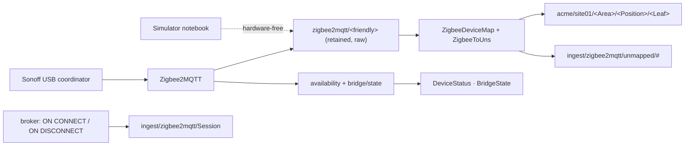

# Zigbee2MQTT + Sonoff USB dongle → a clean UNS

## What this template does

Puts battery-powered Zigbee sensors (temperature, humidity, motion, door contacts) into a
**Unified Namespace** on a Coreflux broker, with no vendor cloud and no hub appliance. A Sonoff USB
coordinator and [Zigbee2MQTT](https://www.zigbee2mqtt.io) own the radio. The broker turns Z2M's
device-shaped feed into position-shaped UNS leaves: one topic per measurement, each with the same
five-key envelope, addressed by *where it is measured*, not by which device happens to sit there.

It is the pattern we run on a small edge gateway, generalised: the decisions that are expensive to change
later (network key, channel, base topic), the Z2M settings that make a UNS honest (`retain`,
`last_seen`, `cache_state`), and a liveness chain that still tells the truth when Z2M itself dies.

## What you will see

- `acme/site01/LivingRoom/Ambient01/Temperature` → `{"value":21.4,"timestamp":"2026-10-06T10:00:00.000Z","datatype":"number","status":"Good","units":"°C"}`
- `Voltage` in **volts**, although Z2M reports millivolts. The leaf owns its unit.
- `Occupancy` and `Contact` as JSON booleans, and `DeviceStatus` per position.
- A freshly paired, not-yet-mapped device on `ingest/zigbee2mqtt/unmapped/<friendly>`, not lost.
- `ingest/zigbee2mqtt/BridgeState` (Z2M's own view) and `ingest/zigbee2mqtt/Session` (the broker's
  view of Z2M's MQTT session).
- Rules: the Z2M account confined to `zigbee2mqtt/#`, the raw plane hidden from applications, pairing
  an operator act.

## Architecture

## Included notebooks

| Notebook | Purpose | When to run |
|---|---|---|
| `zigbee2mqtt-sonoff-uns.lotnb` | Models, the device map, the mapper, liveness, pairing, Rules | Every deployment |
| `zigbee2mqtt-sonoff-uns-simulator.lotnb` | Four SONOFF sensors and one unpaired device, with Z2M's exact payloads | Hardware-free demo only, never next to a real Z2M |

LoT only: no Python, no Routes. Broker **2.14.2 or newer**; verified on 2.14.3
(`VERIFICATION.md`: 21 cells, 23 checks, including the Rules with real accounts).

## Infrastructure and assets

| Path | What |
|---|---|
| `compose/docker-compose.yml` | Coreflux broker 2.14.3 + Hub 2.3.4 + Zigbee2MQTT 2.14.2 on one network, every port on `127.0.0.1` |
| `compose/broker-config.json` | forced on every start: anonymous login **off**, durability **on** |
| `compose/.env.example` | the dongle path and the secret-store key |
| `zigbee2mqtt/configuration.yaml` | the Z2M settings this template relies on, each one explained |
| `zigbee2mqtt/secret.yaml.example` | the Z2M broker password, kept out of `configuration.yaml` |
| `host-install/60-zigbee.rules`, `host-install/zigbee2mqtt.service` | the production form: Z2M as a host service that follows the dongle |

## Topic and data dictionary

| Topic | Example payload | Units | Produced by |
|---|---|---|---|
| `zigbee2mqtt/LivingRoom-SNZB02-01` | `{"temperature":21.4,"humidity":48,"battery":97,"voltage":2900,"linkquality":120,"last_seen":"…"}` | Z2M's | Z2M (or the simulator) |
| `zigbee2mqtt/<friendly>/availability` | `{"state":"online"}` | — | Z2M |
| `acme/site01/<Area>/<Position>/Temperature` | envelope, `value` 21.4 | °C | `ZigbeeToUns` |
| `…/Humidity` · `…/Pressure` · `…/Battery` | envelope | % · hPa · % | `ZigbeeToUns` |
| `…/Voltage` | envelope, `value` 2.9 | V (from mV) | `ZigbeeToUns` |
| `…/LinkQuality` | envelope, 0–255 | `1` (radio quality, not data quality) | `ZigbeeToUns` |
| `…/Occupancy` · `…/Contact` · `…/WaterLeak` · `…/BatteryLow` | envelope, `value` true/false | — (`Contact` true = closed) | `ZigbeeToUns` |
| `…/DeviceStatus` | envelope, `value` online/offline | — | `ZigbeeAvailabilityToUns` |
| `ingest/zigbee2mqtt/BridgeState` · `Session` | envelope | — | `ZigbeeBridgeState` · `ZigbeeSession*` |
| `ingest/zigbee2mqtt/unmapped/<friendly>` | the raw payload | — | `ZigbeeToUns` |
| `ingest/zigbee2mqtt/permit_join` | `120` (seconds) | s | an operator (root) |

**The envelope:** `value` (its JSON type matches `datatype`), `timestamp` (ISO-8601 UTC, the device's
`last_seen`, the *observation* time and never the publish time), `datatype` (`number` · `boolean` ·
`string`), `status` (`Good`: Z2M publishes only successful reads, so degraded data shows up as a
stale `timestamp` or as `DeviceStatus`, never as a `Bad` sample), `units` (numeric leaves only).

## Quick start

### A. Hardware-free (two minutes)

1. Start a broker 2.14.2+ (or `compose/` without the `zigbee2mqtt` service) and open the Hub
   (`http://localhost:3000`, New Connection → Host `coreflux-broker`, port 1883). Change the
   default `root` password first.
2. In `zigbee2mqtt-sonoff-uns.lotnb` run **Models** and **Actions**.
3. Run `zigbee2mqtt-sonoff-uns-simulator.lotnb` top to bottom.
4. Data Viewer: subscribe to `acme/site01/#` and `ingest/zigbee2mqtt/#`. Leaves arrive within 30 s.
5. Run the **Rules** section last.

### B. With a Sonoff dongle

1. `cd compose && cp .env.example .env`. Set `ZIGBEE_DONGLE` (`ls -l /dev/serial/by-id/`) and
   `COREFLUX_SECRET_KEY` (the generator command is in the file).
2. `docker compose up -d coreflux-broker coreflux-hub`. In the Hub, change `root`'s password and
   create the user **`zigbee2mqtt`** with its own password.
3. Prepare Z2M's data folder:
   `mkdir -p z2m-data && cp ../zigbee2mqtt/configuration.yaml z2m-data/ && cp ../zigbee2mqtt/secret.yaml.example z2m-data/secret.yaml`.
   Put the password in `secret.yaml`. Check `serial.adapter` for your dongle model; the file lists them.
   **Decide the channel now**, before anything is paired.
4. Run the solution's **Models** and **Actions**, but **not** the simulator, so the bridge and
   session actions see Z2M's first connection.
5. `docker compose up -d zigbee2mqtt`. `ingest/zigbee2mqtt/BridgeState` says `online`, and
   `ingest/zigbee2mqtt/Session` says `connected`.
6. Pair a sensor: publish `120` to `ingest/zigbee2mqtt/permit_join` and press the sensor's pairing button. Its
   first message appears on `ingest/zigbee2mqtt/unmapped/0x…`. Rename it in the Z2M frontend
   (`http://localhost:8080`, e.g. `LivingRoom-SNZB02-01`), add its line to `ZigbeeDeviceMap`, and
   redeploy that action.
7. Run the **Rules**.

## How it works

**Two planes.** Z2M owns `zigbee2mqtt/#`: device-shaped, retained, its own vocabulary. The UNS
`acme/site01/…` is position-shaped and vendor-neutral. Nothing but the mapper reads the raw plane. An
application that reads a raw topic is a missing UNS leaf, not a shortcut, and Rule 2 enforces that.

**The device map** (`ZigbeeDeviceMap`, `ON START`) is one `KEEP TOPIC` line per device: friendly name
→ UNS position. Replacing a sensor keeps the position and therefore every consumer's subscription
and history. Moving a sensor is one edited line.

**The mapper** (`ZigbeeToUns`) tests every key before publishing it: an attribute exists only once
the device has reported it, and an absent key must publish nothing, not a null. It stamps
`last_seen` only onto what the message carries, which is honest because Z2M runs with
`cache_state: false`.

**Liveness is a chain.** Device availability is computed by Z2M, and only while Z2M runs: if the
Z2M process dies, every device still reads `online`. So three signals are published, and a consumer
trusts a leaf only when all three agree:

- the position's `DeviceStatus`;
- `BridgeState` (Z2M's last will);
- the leaf's `timestamp` age against the device's reporting interval.

`Session` adds the broker's own, independent view of the Z2M connection.

**Retention.** The raw plane is retained by Z2M (`device_options.retain: true`). The clean leaves are
published by LoT as live events. A consumer that needs a value the instant it connects reads the raw
topic once, or waits for the next report.

## Production readiness

### Remove the simulator

Do not run `zigbee2mqtt-sonoff-uns-simulator.lotnb`. Real Z2M publishes the same topics; nothing else
changes.

### Deploy the Rules first

Create `zigbee2mqtt` and your application accounts, deploy the Rules, then connect Z2M. The notebook
keeps the Rules last only so that a demo never locks the deploying session out mid-way.

### Run Z2M as a host service on an unattended gateway

The compose quick start maps the dongle into a container. That mapping is resolved **once, when the
container is created**. If the dongle re-enumerates (another USB port, a replug, a powered hub coming
up in a different order, a kernel update), the container keeps pointing at a device that is no longer
the coordinator until it is recreated. Mapping `/dev/serial/by-id/…` does not help, because the symlink
is resolved at the same moment.

`host-install/` is the robust form:

- `60-zigbee.rules` gives the dongle a fixed name (`/dev/zigbee`), keyed to its serial number, and
  keeps ModemManager off the port. ModemManager probes new serial devices with AT commands, which
  shows up as an *intermittent* failure to start.
- `zigbee2mqtt.service` binds to that device and is `WantedBy=` it, so the dongle starts and stops
  the service: at boot, and on every replug into any port. Install it with `systemctl reenable` if an
  earlier copy was `WantedBy=multi-user.target`.
- `zigbee-replug-wait.conf` goes to `/etc/systemd/system/dev-zigbee.device.d/`. When the dongle is
  pulled, Z2M exits on its own (code 2) and `Restart=always` queues a restart that waits for the
  device. systemd gives a device 90 s; after that the restart fails as `Dependency failed`, nothing
  retries it, and the replug starts nothing. The drop-in lifts that timeout, so a replug after any
  length of time brings Z2M back without a hand on the gateway. Nothing at boot waits for it,
  because the unit is not under `multi-user.target`.

In `configuration.yaml`, set `mqtt.server` to `mqtt://127.0.0.1:1883` for a broker on the same host.

### Back up the data folder, and know what a rebuild means

Z2M's data folder holds the **network key and the device database**: losing it means re-pairing every
device by hand. Back it up as a whole.

The Zigbee network lives in four places, and only one of them is `configuration.yaml`:

| Where | What it holds |
|---|---|
| `configuration.yaml` | the parameters Z2M will *ask* for |
| `coordinator_backup.json` | the network Z2M *formed* |
| the dongle's own memory | the network *itself* |
| `database.db` | the devices paired to it |

Rewriting `configuration.yaml` with new keys while the other three still hold the old network makes
Z2M refuse to start with `configuration-adapter mismatch`. That refusal is deliberate, and it protects
you. To really start a new network:

1. Stop Z2M.
2. Move `coordinator_backup.json`, `database.db` and `state.json` aside, and keep them: they are the only
   record of the old network.
3. Start Z2M with the new configuration.

Re-pairing every device is the price.

### Credentials and secrets

- `COREFLUX_SECRET_KEY` pinned (compose `.env`) and stored in your password manager.
- Z2M's broker password lives in `secret.yaml`, never in `configuration.yaml` or git.
- After the first start, `configuration.yaml` holds the generated network key: treat the whole data
  folder as a secret.

### Network exposure

Bind 1883 to the network your devices use, deliberately. The Z2M frontend has no authentication until
you set `frontend.auth_token`; keep it on localhost or behind your access layer.

## Adapting this template

1. **UNS root and positions**: edit the right-hand side of each `ZigbeeDeviceMap` line. The
   mapper writes wherever the map points; no other change.
2. **Another sensor type**: copy one key block in `ZigbeeToUns` (raw key → leaf, unit). Check the
   device's page on zigbee2mqtt.io for the exact key and unit, and convert to the unit the leaf
   should own.
3. **A second Z2M instance** (another radio, another building): give it its own `base_topic` and
   account, and copy the mapper with that topic and its own map prefix.
4. **Actuators** (plugs, valves): map a UNS `…/set` topic back to `zigbee2mqtt/<friendly>/set` in an
   action with `PUBLISH TOPIC` (an action's `PUBLISH MODEL` is subject to the raw-plane Rule).

## Security notes

- Z2M's account is confined to `zigbee2mqtt/#` both ways (Rules 1–4); it cannot write into the UNS.
- Applications cannot read or forge the raw plane, and cannot open the network for pairing (Rule 5).
- The network key is generated per install (`GENERATE`). Z2M's built-in defaults are public constants.
- External JavaScript converters are off (`enable_external_js: false`), and automatic OTA checks are
  off. Updating firmware is a deliberate act.
- Anonymous login is off in `broker-config.json`. Change the default `root` password before
  anything else.

## Field notes

Lessons from running this pattern on real hardware, kept here because none of them is obvious:

- **`cache_state` fabricates freshness.** Z2M's default `true` re-sends every attribute ever
  reported, under one `last_seen`. A battery leaf then never looks stale, and a historian stores
  copies of old values with new timestamps.
- **A dead battery reads `online` for a day.** The passive availability timeout is 25 h, because pinging
  a sleeping device drains it. Leaf freshness is the earlier signal.
- **A sensor's first motion creates the `occupancy` key.** Until then, the key does not exist.
  Mappers must treat "absent" as "not reported", never as false or zero.
- **Decide the channel and keys before pairing.** Channel 25 avoids the common WiFi channels; a few
  very old devices reject 26.
- **ModemManager** on a desktop or general-purpose image grabs CP210x ports intermittently. The udev
  rule's `ID_MM_DEVICE_IGNORE` settles it.
